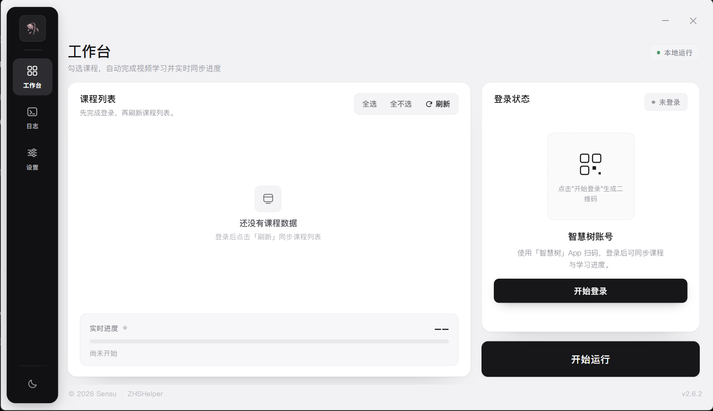

  

<h1 align="center">ZHSHelper</h1>

<strong>智慧树网课自动学习助手 · Windows 桌面端</strong>

  
  
  
  

  <a href="https://suzume.cloud/downloads/ZHSHelper-Setup.exe"><strong>下载安装包</strong></a>
  &nbsp;·&nbsp;
  <a href="https://suzume.cloud/projects/zhshelper">项目主页</a>

---

ZHSHelper 是一个面向智慧树平台的 Windows 桌面工具：扫码登录后自动完成已勾选课程的视频学习，实时同步进度，遇到人机验证时把验证交还给你，其余时间可以挂着做自己的事。

## 功能

- **两类课程**：支持知到共享学分课与校内学分课（Hike），统一在一个列表里管理。
- **自动学习**：按章节顺序播放视频，完成度实时回传，进度一目了然。
- **扫码登录**：使用「智慧树」App 扫码，登录凭据保存在本机，下次启动自动恢复。
- **人机验证辅助**：检测到验证后，一键打开登录页并自动填入账号密码，验证通过后自动跳到对应课程。
- **实时日志**：独立的「日志」页展示运行与登录输出，按级别着色，支持自动滚动与清空。
- **浅色 / 深色主题**：导航栏底部一键切换，选择会被记住。

## 界面

浅色为默认主题：`#F2F2F4` 背景、白色面板、悬浮式黑色导航栏；暗色为纯色体系，没有渐变光效。课程列表、实时进度、登录状态和运行控制集中在工作台，日志与设置各占一个独立页签。

> 界面截图与更多说明见 [项目主页](https://suzume.cloud/projects/zhshelper)。

## 下载与安装

1. 前往 [下载安装包](https://suzume.cloud/downloads/ZHSHelper-Setup.exe)（Windows 10 / 11）。
2. 运行 `ZHSHelper-Setup.exe` 完成安装。
3. 若 Windows SmartScreen 提示未知发布者，选择「更多信息 → 仍要运行」。

安装版会把 `config.json`、`cookies.json`、`gui_state.json` 与 `logs\` 放在程序目录，覆盖安装不会删除这些数据。

## 使用

1. **登录**：点击「开始登录」，用「智慧树」App 扫描二维码。
2. **同步课程**：登录成功后点击「刷新」，勾选要学习的课程。
3. **调整参数（可选）**：在「设置」里修改倍速、完成阈值与单课时限。不同学校监测力度不同，**不建议超过 8 倍速**。
4. **开始运行**：点击右侧「开始运行」，进度条与当前课程会实时更新。
5. **处理验证**：出现人机验证时按下方说明操作。
6. **查看日志**：切换到「日志」页可以看到完整的运行输出。

## 人机验证

刷课过程中平台可能要求人机验证。检测到验证后，进度条下方会出现提示与「打开验证页」按钮：

1. 程序用内置浏览器打开智慧树登录页（`login.zhihuishu.com`），并自动填入「设置 → 浏览器验证凭据」里保存的账号和密码；
2. **验证码由你本人完成**，程序不会尝试绕过；
3. 登录进入课程页面后，会自动跳转到触发验证的那门课（知到课直达视频页，校内学分课打开 Hike 门户）；
4. 完成验证后回到 ZHSHelper，重新点击「开始运行」继续。

账号密码只保存在本机 `config.json`，不会上传到任何服务器。登录页结构若有调整，自动填充可能失效，此时在弹出窗口里手动输入即可。

## 常见问题

**二维码过期或登录失败？**
点击「开始登录」或「重新登录」重新生成二维码；若持续失败，检查网络或代理设置。

**验证完成后仍然提示验证？**
先在应用内重新登录刷新会话，再重新开始运行。部分课程需要等待几分钟才会解除限制。

**校内学分课为什么没有直接进入视频？**
Hike 没有公开的课程深链，验证后会打开课程门户，需要手动点进对应课程。

**日志关掉就没了？**
「日志」页只保留本次会话的输出（最多 800 行）。完整历史仍写入程序目录下的 `logs\`。

**数据保存在哪里？**
`config.json`、`cookies.json`、`gui_state.json` 与 `logs\` 都位于程序所在目录；卸载时可选择是否保留。

## 免责声明

本项目仅供学习与交流使用。请遵守智慧树平台的服务条款以及所在学校的规定，因使用本工具产生的一切后果由使用者自行承担。

## 许可

[MIT License](LICENSE) © 2026 Sensu

---

如果这个项目对你有帮助，欢迎点一个 Star。
